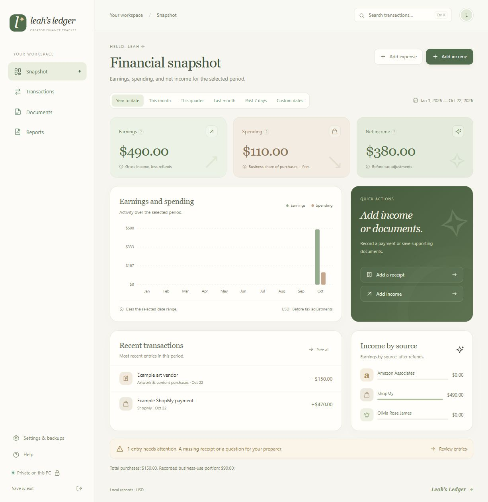

# Leah’s Ledger

A simple, offline Windows finance tracker for a creator business. Warm cream, sage and forest greens, brown accents, elegant serif headings, and friendly explanations throughout.



The preview contains synthetic sample data. A new ledger starts empty.

## Run on a Windows PC

1. Download **LeahsLedger.exe** from this repository’s **Releases** page.
2. Put it in a folder you want to keep, such as Documents\LeahsLedger.
3. Double-click it. No Python, Microsoft Word, subscription, or development tools are needed.
4. Use **Money in**, **Money out**, and **Documents** to begin. Your actual ledger starts empty.
5. Choose **Save & exit** when you finish. Use **Settings & backups → Export full backup** regularly and keep that ZIP somewhere besides this PC.

Requires Windows 10/11 (64-bit) and Microsoft Edge. Edge provides the app window; the ledger itself runs locally and works offline. If Edge is unavailable, the app opens in the default browser. The executable is an unsigned personal app, so Windows may display a reputation warning. Do not disable Windows security to run it.

## What’s included

- **Snapshot:** earnings, spending, and net income for year to date, this month, this quarter, last month, past seven days, or custom dates. A custom range can cover a single day or any previous year.
- **Transactions:** income and expenses, source/platform, payer or vendor, category, campaign/painting, notes, and optional account labels. Search, filter, edit, and undo a removal immediately.
- **Income detail:** gross earnings, withheld fees, refunds, and the resulting net deposit. Direct deposit is preselected. Income and its matching bank deposit should be entered once.
- **Business use:** record a purchase’s personal/business split. Artwork and equipment categories automatically flag a preparer question; the user can update that flag.
- **Documents:** original screenshots, photos, PDFs, statements, contracts, and other files, up to 25 MB each. Images, PDFs, and text can be previewed. Other originals can be downloaded. Attach files to entries, reuse a saved document, drag files in, or paste a screenshot into an entry.
- **Reports:** full calendar year, calendar quarter, or custom range; PDF, editable Word DOCX, CSV, and a ZIP package with the supporting originals. Statements and tax forms are included by their assigned tax year, even without a transaction link.
- **CSV import:** map columns, preview, validate, then import. Possible duplicates match on date, type, name, and amount; skipping them is optional.
- **Recovery:** automatic local backups, full backup exports, verified restore, and a recovery copy before replacing a ledger. The 30 most recent automatic/recovery backups are kept.

Preloaded sources are Amazon Associates, ShopMy, and **Olivia Rose James · Royals**. Additional sources and vendors can be entered directly. A painting purchase and its later promotional earnings can share a campaign name while remaining separate records. The official [Royals Affiliate Collective](https://www.oliviarosejames.com/royals) is an income source; the app does not assume a particular commission rate or guarantee any earnings.

## What the numbers mean

The snapshot uses the selected received/paid dates and USD:

```text
Earnings   = gross income − refunds
Spending   = recorded business portion of purchases + withheld fees
Net income = Earnings − Spending
```

The full purchase amount and the recorded business portion are retained separately. Fees entered on income are counted once. Net income is a **bookkeeping result before tax adjustments**, not final taxable income. Review flags are visible in reports, and flagged purchases remain included at their recorded business-use percentage.

Purchasing art for promotional content does not establish a deduction. The purpose, business-use percentage, documents, and preparer question are preserved for review. This version organizes records; it does not file tax returns, determine deductions, calculate estimated taxes, or perform depreciation.

## Data and privacy

Actual records are stored in:

```text
%LOCALAPPDATA%\LeahsLedger\
  ledger.sqlite3       Transactions, links, settings, and edit history
  documents\           Copied original files
  backups\             Local recovery ZIP files
  window-profile\      Dedicated app window profile
```

This folder is separate from the executable and the GitHub checkout. Updating the app does not replace the ledger. The server binds only to `127.0.0.1`, uses a per-launch access token, and checks request host and origin. There is no telemetry, cloud sync, bank login, or external platform connection. The ledger is not encrypted by the app; protect the Windows account and exported backups appropriately.

Automatic backups are made on startup, on the first save each day, on explicit request, before restore, and on Save & exit. Local copies are on the same disk and do not protect against disk failure. Full backup exports include every record and original document. Report packages contain only the selected transactions, their linked documents, and relevant yearly statements/forms; other unlinked receipts and contracts remain in Documents.

To move records to another PC: export a full backup, copy the ZIP, run the app there, and use **Settings & backups → Restore from a backup**. Restore replaces that PC’s existing ledger after making a recovery backup. Full-backup restores support ZIPs up to 2 GB, with up to 4 GB of uncompressed contents.

Do not add real financial records, receipts, statements, backups, account details, or the data folder to this public repository. The `examples/` files contain clearly labeled synthetic data only. The development preview uses a separate `.preview-data` folder that is ignored by Git.

## Build or run from source

Use Python 3.12 or later on Windows:

```powershell
python -m venv .venv
.\.venv\Scripts\Activate.ps1
python -m pip install -r requirements-dev.txt
python -m unittest discover -s tests -v
python app.py
```

Build the standalone executable:

```powershell
.\scripts\build_windows.ps1
```

Output: `dist/LeahsLedger.exe` and `dist/SHA256SUMS.txt`. The GitHub Actions workflow also tests and builds the Windows executable as a downloadable workflow artifact.

For isolated testing without opening a window:

```powershell
python app.py --no-window --data-dir .preview-data
```

Open the local URL printed by the command. Never commit that URL or its launch token. Stop with Ctrl+C or the app’s Save & exit command.

## Current boundaries

Single user, one PC, USD, received/paid cash records. CSV import supports a single amount column and ISO (`YYYY-MM-DD`) or US (`MM/DD/YYYY`) dates; a preview lets you choose the sign convention. It does not automatically reconcile bank deposits to platform payouts or import multi-column fee breakdowns. Receipt text recognition, direct bank feeds, phone sync, mileage logs, unpaid-invoice tracking, and noncash compensation workflows are not included in this first release.

Licensed under the MIT license. Third-party runtime notices accompany the Windows release.
